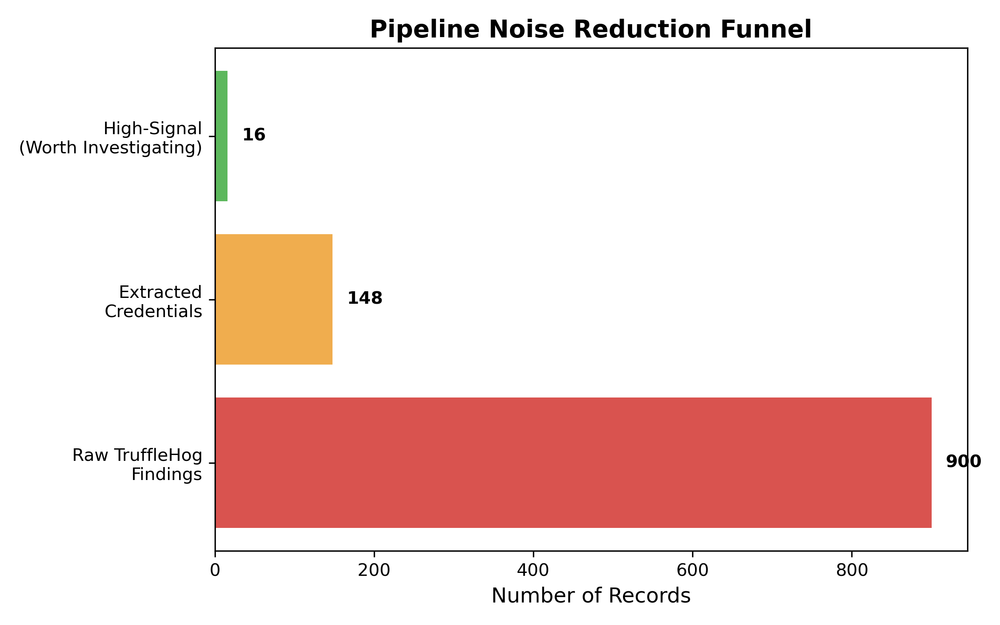
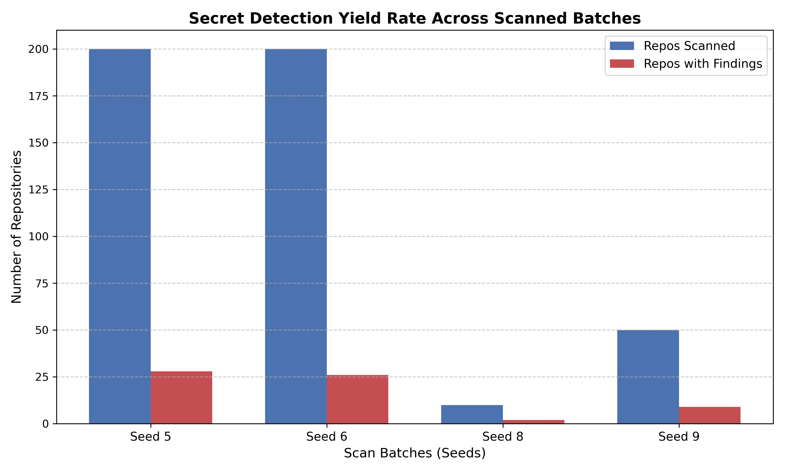

# 🕵️ Secret Scanner & Credential Triage Pipeline

An automated security research pipeline designed to identify accidentally committed secrets in GitHub repositories, classify potential credential exposures, reduce irrelevant findings, and support responsible disclosure.

The project uses **TruffleHog** for repository scanning and Git history analysis, combined with a custom Python pipeline for data processing, classification, filtering, reporting, and visualization.

---

## 🎯 Research Objective

The objective of this project is to study accidental credential exposure in GitHub repositories, understand the limitations of automated secret detection, and investigate the relationship between static credential exposure and infrastructure vulnerability.

### Research Question

To what extent do credentials extracted from public GitHub repositories represent actual valid authentications versus false positives, when evaluated across:

1. Extraction accuracy.
2. Live connection validity.
3. Infrastructure reachability.

---

## 📌 Project Overview

The project consists of eight stages:

| Stage | Description |
|---|---|
| 1. Repository Discovery | Generate reproducible samples of GitHub repositories. |
| 2. Secret Detection | Scan authorized repositories and their Git history using TruffleHog. |
| 3. Credential Analysis | Identify potential username-password exposures and other credential-related findings. |
| 4. Noise Filtering | Remove known placeholders, test fixtures, duplicates, and irrelevant findings. |
| 5. Reporting | Consolidate research findings into a structured Excel report. |
| 6. Data Preparation | Convert consolidated findings into a standardized CSV format. |
| 7. Live Verification | Evaluate credential validity and infrastructure reachability in explicitly authorized environments. |
| 8. Data Exploration | Evaluate database exposure scope and sensitive field categories in authorized environments. |

### Pipeline Workflow

**Repository Discovery → Secret Scanning → Credential Analysis → Noise Filtering → Excel Reporting → Data Preparation → Live Verification → Data Exploration**

The main automated pipeline coordinates the first five stages. Data preparation, verification, and database exploration are separate research components.

---

## 🛠️ Prerequisites

Ensure the following dependencies are installed before running the pipeline.

### 1. Python

- Python 3.8 or above
- pip package manager
- Git

### 2. TruffleHog

TruffleHog must be installed and available on your system PATH.

**macOS**

```bash
brew install trufflehog
```

**Linux / WSL**

Download the appropriate binary from the [official TruffleHog Releases page](https://github.com/trufflesecurity/trufflehog/releases) and add it to your system PATH.

### 3. Python Libraries

Using a virtual environment is recommended to avoid dependency conflicts.

```bash
python3 -m venv venv
source venv/bin/activate
pip install pandas openpyxl pymongo psycopg2-binary PyMySQL redis requests
```

Additional dependencies for visualization and detector configuration:

```bash
pip install matplotlib PyYAML
```

| Library | Purpose |
|---|---|
| pandas | Data processing, analysis, and consolidation. |
| openpyxl | Excel spreadsheet generation. |
| pymongo | MongoDB database driver. |
| psycopg2-binary | PostgreSQL database driver. |
| PyMySQL | MySQL/MariaDB database driver. |
| redis | Redis/KeyDB database driver. |
| requests | HTTP requests and API communication. |
| matplotlib | Generation of experimental graphs. |
| PyYAML | Reading custom YAML detector configurations. |

---

## 🚀 Full Pipeline Execution Flow
**1. Set GitHub token (to avoid API rate limits)**
export GITHUB_TOKEN=ghp_your_token_here

**2. Run the automated pipeline**
**Pass the random seed and the number of repositories you want to scan**
**Change the seed (2, 3, 4...) to get completely new batches**
python3 run_pipeline.py 2 
python3 prepare_findings.py --input all_investigating_credentials.xlsx --output findings_annotated.csv
python3 db_tester.py --input findings_annotated.csv --output verified_credentials.csv --workers 10
python3 db_read_only_explore.py


The automated orchestrator accepts a random seed as its command-line argument. The repository sample size and worker count are predefined in the current implementation.

All scanning and active assessment must be restricted to explicitly authorized repositories and services or controlled test environments.

---

## 🚀 Pipeline Execution

### Step 1: Discover Repositories

**Script:** `sample_github_api.py`

The repository discovery script uses the GitHub API to generate reproducible repository samples for research.

| Parameter | Description |
|---|---|
| `--sample` | Number of repositories to sample. |
| `--seed` | Random seed used for reproducibility. |
| `--out` | Output filename. |

Different seeds allow researchers to obtain different repository samples while maintaining reproducibility.

Repository samples should be reviewed for authorization before scanning.

### Step 2: Scan with TruffleHog

**Script:** `scan.py`

The scanner uses TruffleHog to examine authorized repositories and their Git history for potential secret exposures.

The scanning process includes:

- Repository cloning.
- Git history analysis.
- Secret detection.
- Progress tracking.
- Findings collection.
- Resume support.

| Parameter | Description |
|---|---|
| `--repos-file` | Input repository list. |
| `--workers` | Number of concurrent scanning workers. |
| `--progress` | Progress tracking filename. |

Execution time depends on repository size, network speed, available hardware, and the number of repositories.

The progress tracking mechanism allows interrupted scans to resume rather than restart entirely.

### Step 3: Credential Analysis

**Script:** `check_secrets.py`

This stage processes scanner output and identifies potential credential-related findings.

It distinguishes relevant credential patterns from unrelated secret types and organizes records for subsequent analysis.

The research scope includes potential username-password pairs and authentication-related connection strings.

Third-party credentials should remain redacted, and full-value demonstrations should be restricted to synthetic credentials.

### Step 4: Filter Out Noise

**Script:** `filter_credentials.py`

Initial scanner results may contain false positives, example credentials, placeholders, duplicate records, and test data.

This stage reduces irrelevant findings by identifying common patterns that are unlikely to represent genuine exposures.

| Category | Example |
|---|---|
| Default credentials | `postgres:postgres` |
| Generic placeholders | `user:password` |
| Environment placeholders | `__DB_USER__` |
| Repeated default values | `db1:db1` |
| Test fixtures | Synthetic authentication data. |
| Documentation examples | Example configurations. |
| Duplicate findings | Repeated research records. |

The filtered output contains higher-signal findings requiring further investigation.

A retained finding does not necessarily represent a valid or active credential.

### Step 5: Review and Generate Excel

**Script:** `make_excel.py`

This stage consolidates research findings from multiple scanning batches into a structured Excel spreadsheet.

The script uses pandas and openpyxl to organize research records and remove duplicate entries.

**Output filename:** `all_investigating_credentials.xlsx`

Original spreadsheets containing sensitive information must remain private. Only redacted or anonymized versions should be distributed.

### Step 6: Data Preparation & Normalization

**Script:** `db_verifier/prepare_findings.py`

This stage converts consolidated Excel findings into a standardized CSV format.

The script handles data cleaning, normalization, column mapping, and consistency across experimental batches.

**Input:** `all_investigating_credentials.xlsx`

**Output:** `findings_annotated.csv`

The standardized research records include source information, repository metadata, detector classifications, file references, commit information, and credential-related fields.

### Step 7: Live Credential Verification

**Script:** `verify_credentials.py`

This separate research component evaluates credential validity and infrastructure reachability within explicitly authorized environments.

The verifier supports different database and authentication protocols and categorizes assessment outcomes into standardized statuses.

| Status | Description |
|---|---|
| `SUCCESS` | Successful authentication reported during assessment. |
| `INVALID_CREDENTIALS` | Authentication was rejected. |
| `UNREACHABLE` | The target could not be reached during assessment. |
| `INTERNAL_HOST` | The finding refers to an internal or local service. |
| `CLUSTER_DELETED` | Classification used for certain unavailable MongoDB clusters. |

**Output:** `verified_credentials.csv`

An unreachable endpoint does not necessarily establish that the underlying infrastructure has been deleted. Similarly, authentication failure does not necessarily establish that a password has been rotated.

### Step 8: Data Exploration & Impact Assessment

**Script:** `db_verifier/db_read_only_explore.py`

This separate research component was developed to evaluate the potential scope and sensitivity of accessible database information in authorized environments.

The research assessment considers database structures, collection categories, and sensitive field types.

**Output:** `db_exploration_results.xlsx`

The generated workbook contains the following sheets:

| Sheet | Description |
|---|---|
| Summary | High-level database assessment observations. |
| Samples | Structured research observations collected during assessment. |
| Sensitive_Findings | Classification of potentially sensitive field types. |

Only anonymized aggregate observations should be included in academic reports and distributed project files.

---

## 📂 Project Files and Folder Structure

### Core Pipeline Scripts

| File | Description |
|---|---|
| `run_pipeline.py` | Main entry point of the automated pipeline. Coordinates repository discovery, secret detection, credential analysis, noise filtering, and Excel consolidation. |
| `sample_github_api.py` | Uses the GitHub REST API to generate reproducible repository samples based on random seeds. |
| `scan.py` | Integrates TruffleHog with the Python pipeline for static secret detection and Git history analysis. Maintains scan progress and supports resumability. |
| `check_secrets.py` | Processes raw scanner findings and identifies credential-related records relevant to the research scope. |
| `filter_credentials.py` | Applies heuristic classification to filter default credentials, placeholders, documentation examples, test fixtures, irrelevant findings, and duplicates. |
| `make_excel.py` | Consolidates shortlisted findings from multiple experimental batches into an Excel workbook using pandas and openpyxl. |
| `verify_credentials.py` | Separate research component for evaluating credential validity and infrastructure reachability within authorized environments. |

### Database Assessment Files

| File | Description |
|---|---|
| `db_verifier/prepare_findings.py` | Converts consolidated Excel findings into a standardized CSV format and performs data normalization. |
| `db_verifier/db_read_only_explore.py` | Research component for evaluating database exposure scope and sensitive field categories within authorized environments. |
| `db_verifier/db_exploration_results.xlsx` | Generated workbook containing database assessment observations and sensitive-field classifications. |

### Configuration and Testing Files

| File | Description |
|---|---|
| `detectors.yaml` | Contains custom regular-expression-based detector configurations for credential-related patterns. |
| `detector_check.py` | Tests custom detector configurations using sample inputs. |
| `.gitignore` | Defines files and directories that should be excluded from Git version control. |
| `README.md` | Contains project documentation, installation instructions, execution information, file descriptions, and experimental results. |

### Visualization Scripts

| File | Description |
|---|---|
| `make_graph.py` | Generates a comparative bar chart showing repositories scanned and repositories containing findings across experimental batches. |
| `make_funnel_graph.py` | Generates a horizontal bar chart illustrating the reduction in records across raw detection, credential analysis, and heuristic filtering. |

---

## 📁 Repository Sampling Files

These files contain repository samples generated during different experimental batches.

| File | Description |
|---|---|
| `repos_seed5.txt` | Repository sample associated with random seed 5. |
| `repos_seed6.txt` | Repository sample associated with random seed 6. |
| `repos_seed8.txt` | Repository sample associated with random seed 8. |
| `repos_seed9.txt` | Repository sample associated with random seed 9. |
| `repos_seed8_new.txt` | Seed 8 repository list after excluding previously processed repositories. |
| `repos_seed9_new.txt` | Seed 9 repository list after excluding previously processed repositories. |
| `already_scanned.txt` | Maintains a record of previously scanned repositories to reduce redundant processing across experimental batches. |

---

## 📄 Raw Scanner Output Files

These files contain raw findings collected during different experimental runs.

| File | Description |
|---|---|
| `findings.json` | Structured raw findings collected during an experimental scan. |
| `findings_seed5.json` | Raw findings associated with the seed 5 experimental batch. |
| `findings_v2.json` | Raw findings collected during an earlier version of the scanning pipeline. |

---

## 📄 Scan Progress Files

Progress files maintain intermediate findings and allow interrupted experiments to resume.

| File | Description |
|---|---|
| `scan_progress.jsonl` | Scan progress and intermediate findings from an experimental run. |
| `scan_progress_seed5.jsonl` | Scan progress and findings associated with seed 5. |
| `scan_progress_seed6.jsonl` | Scan progress and findings associated with seed 6. |
| `scan_progress_seed8.jsonl` | Scan progress and findings associated with seed 8. |
| `scan_progress_seed9.jsonl` | Scan progress and findings associated with seed 9. |
| `progress_v2.jsonl` | Progress records from an earlier experimental iteration. |
| `progress_v2_clean.jsonl` | Processed version of earlier scan progress records. |

JSONL files store individual JSON records on separate lines, allowing incremental processing and progress tracking.

---

## 📄 Intermediate Credential Analysis Files

These files contain intermediate research records produced during the credential analysis stage.

| File | Description |
|---|---|
| `credentials_extracted.jsonl` | Intermediate credential-analysis records from an experimental run. |
| `credentials_extracted_2.jsonl` | Credential-analysis records from an additional experimental run. |
| `credentials_extracted_3.jsonl` | Credential-analysis records from a subsequent experimental run. |
| `credentials_seed8.jsonl` | Credential-analysis records associated with seed 8. |
| `credentials_seed9.jsonl` | Credential-analysis records associated with seed 9. |

These files represent intermediate records before heuristic filtering and duplicate removal.

---

## 📄 Filtered Credential Files

These files contain higher-signal findings retained after heuristic filtering.

| File | Description |
|---|---|
| `worth_investigating.jsonl` | Shortlisted findings retained after filtering. |
| `worth_investigating_3.jsonl` | Shortlisted findings from an additional experimental run. |
| `worth_investigating_seed8.jsonl` | Filtered findings associated with seed 8. |
| `worth_investigating_seed9.jsonl` | Filtered findings associated with seed 9. |

A retained record represents a finding requiring further review and does not necessarily represent a valid or active credential.

---

## 📑 Final Research Output Files

| File | Description |
|---|---|
| `all_investigating_credentials.xlsx` | Consolidated Excel workbook containing shortlisted research findings across multiple experimental batches. |
| `findings_annotated.csv` | Standardized CSV containing normalized research records and associated metadata. |
| `verified_credentials.csv` | Contains reported credential validity and infrastructure reachability assessment outcomes. |
| `verified_results.csv` | Contains additional experimental verification outcome records. |
| `db_exploration_results.xlsx` | Generated database assessment workbook containing research observations and sensitive-field classifications. |

These files are generated research artifacts and are not required for a fresh installation.

Original records containing credentials, authentication secrets, or personal information must be stored privately. Only anonymized or redacted versions should be included in the distributed repository.

---

## 📂 Folder Descriptions

| Folder | Description |
|---|---|
| `db_verifier/` | Contains database assessment and research data preparation components, along with associated experimental outputs. |
| `figures/` | Contains graphical representations of experimental results used in the research paper and presentation. |
| `reports/` | Automatically generated directory containing research reports and disclosure drafts. Not required in the distributed repository. |
| `venv/` | Local Python virtual environment containing installed dependencies. Automatically generated during environment setup. |
| `__pycache__/` | Automatically generated directory containing compiled Python bytecode. |
| `.git/` | Contains Git repository metadata and version history. |

### Main Directory Structure

```text
OS-Project/
│
├── README.md
├── .gitignore
│
├── run_pipeline.py
├── sample_github_api.py
├── scan.py
├── check_secrets.py
├── filter_credentials.py
├── make_excel.py
│
├── detectors.yaml
├── detector_check.py
│
├── verify_credentials.py
│
├── make_graph.py
├── make_funnel_graph.py
│
├── db_verifier/
│   ├── prepare_findings.py
│   ├── db_read_only_explore.py
│   └── db_exploration_results.xlsx
│
└── figures/
    ├── graph_funnel.png
    └── scan_yield_graph.png
```

Repository sampling files, raw scanner outputs, progress files, intermediate credential records, and final research outputs are stored separately in the project directory and documented in the preceding sections.

---

## 📊 Generating Experimental Graphs

The project includes two visualization scripts for analyzing the experimental results.

### Repository Detection Yield Graph

```bash
python3 make_graph.py
```

**Output:** `scan_yield_graph.png`

This graph compares the number of repositories scanned against the number of repositories containing findings across different experimental batches.

### Pipeline Noise Reduction Graph

```bash
python3 make_funnel_graph.py
```

**Output:** `graph_funnel.png`

This graph illustrates the reduction in records across raw secret detection, credential analysis, and heuristic filtering.

The generated graphs can be placed inside the `figures/` directory.

---

## 📊 Experimental Setup and Results

The experiments were conducted using a Windows Subsystem for Linux (WSL) environment.

Four experimental batches were evaluated using the following random seeds:

- Seed 5
- Seed 6
- Seed 8
- Seed 9

The findings from these experimental batches were consolidated for statistical analysis, comparison, and visualization.

### Pipeline Noise Reduction

| Pipeline Stage | Number of Records |
|---|---:|
| Raw TruffleHog Findings | 900 |
| Extracted Credential Records | 148 |
| High-Signal Findings | 16 |

The pipeline achieved an overall record reduction of approximately **98.22%**.

This percentage represents the reduction in retained records after credential analysis and heuristic filtering, rather than a measured false-positive rate.



**Figure 1:** Pipeline noise reduction across raw findings, extracted credential records, and high-signal findings.

### Secret Detection Yield Across Experimental Batches

The following graph compares repositories processed against repositories containing findings across different experimental batches.



**Figure 2:** Secret detection yield across experimental batches.

### Reported Network Validity Assessment

The research paper reports the following outcomes for the 16 shortlisted credential records.

| Assessment Outcome | Count | Percentage |
|---|---:|---:|
| Unreachable | 8 | 50% |
| Internal Host | 4 | 25% |
| Invalid Credentials | 2 | 12.5% |
| Successful Authentication | 2 | 12.5% |
| **Total** | **16** | **100%** |

These findings highlight the difference between static credential exposure and authentication validity.

---

## 🔍 Key Research Findings

- Static secret detection produces a substantial number of findings requiring further classification.
- Heuristic filtering significantly reduces the number of records requiring manual review.
- A credential-related string detected in source code does not necessarily represent an active credential.
- Infrastructure reachability and authentication validity are distinct aspects of security assessment.
- Historical configurations, placeholders, test fixtures, and internal services may remain detectable within Git history.
- Combining static detection with contextual analysis provides a more informative approach to credential exposure assessment.

---

## ⚠️ Research Limitations

- The experimental repository samples do not necessarily represent the entire GitHub population.
- Heuristic filtering may exclude genuine credential exposures.
- Network failures do not necessarily establish that infrastructure has been permanently deleted.
- Authentication failures do not establish the reason a credential is invalid.
- Record reduction should not be interpreted as a measured false-positive rate without independent ground-truth labels.

---

## 🛑 Responsible Disclosure Rules

All findings must be handled ethically, securely, and legally.

- Active assessment must be restricted to explicitly authorized systems and controlled research environments.
- Public repository visibility does not constitute authorization to access associated services.
- Actual credentials, authentication secrets, and personal information must not be published.
- Sensitive generated files must be excluded from version control.
- Research findings should be anonymized before academic distribution.
- Potential credential exposures should be responsibly disclosed to their respective owners.

---

## 📚 References

1. Truffle Security. [TruffleHog: Find, Verify, and Analyze Leaked Credentials](https://github.com/trufflesecurity/trufflehog).

2. OWASP Foundation. [Secrets Management Cheat Sheet](https://cheatsheetseries.owasp.org/cheatsheets/Secrets_Management_Cheat_Sheet.html).

3. Feng et al. (2022). Automated Detection of Password Leakage from Public GitHub Repositories. Proceedings of the International Conference on Software Engineering (ICSE).


---

**For educational, authorized security research, and responsible disclosure purposes only.**
